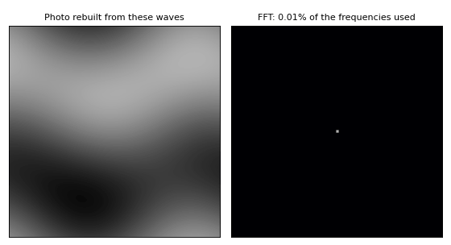
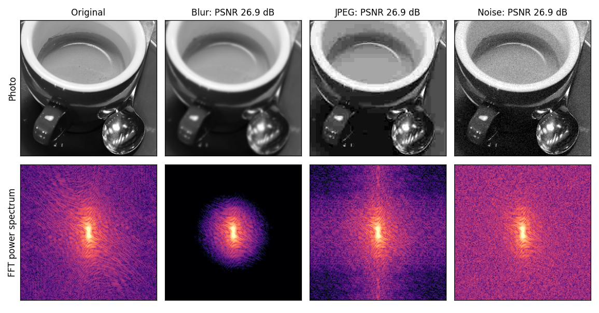
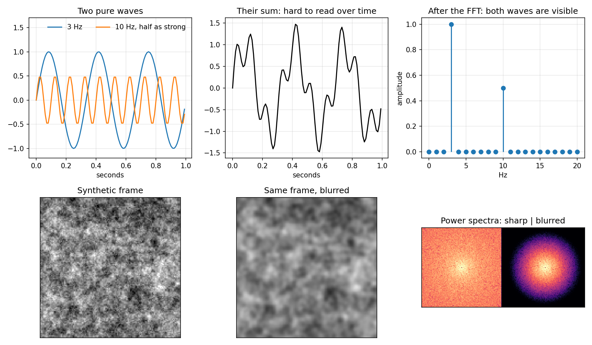
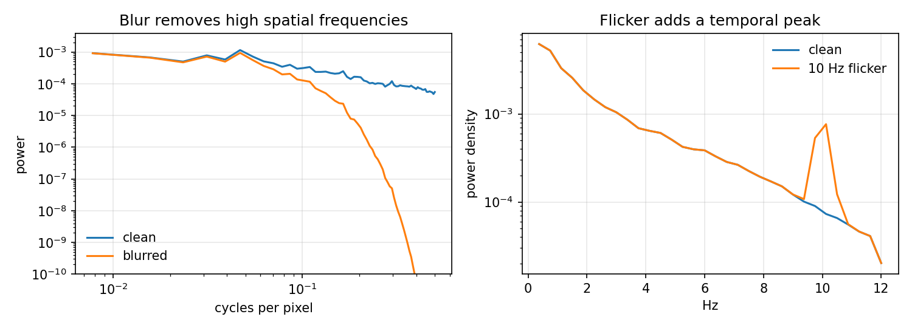
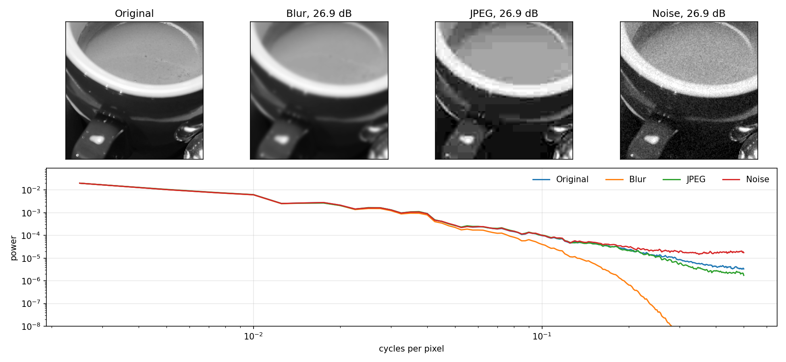
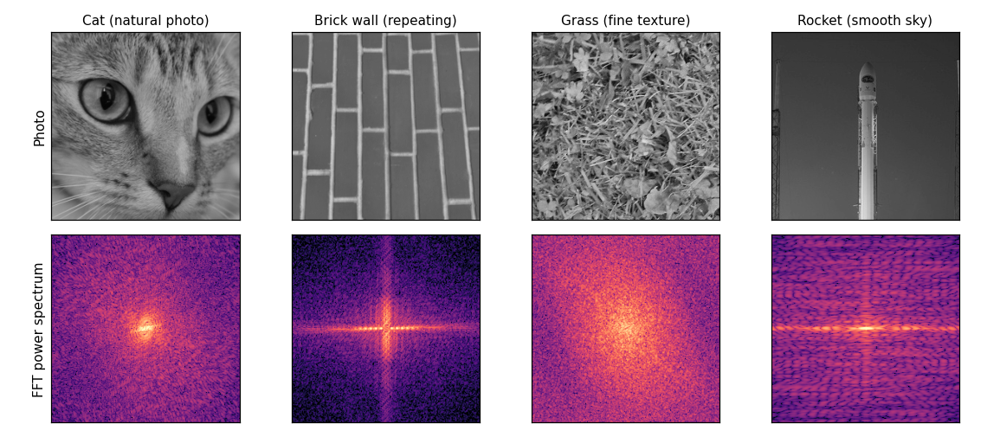
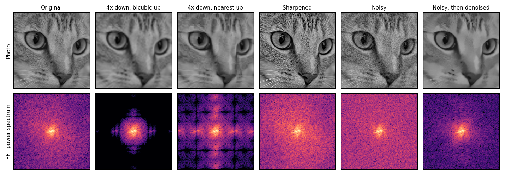
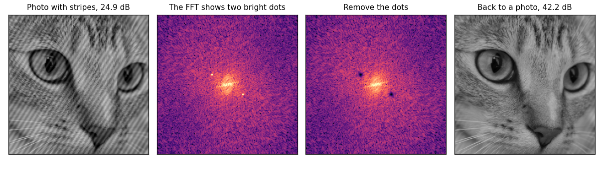
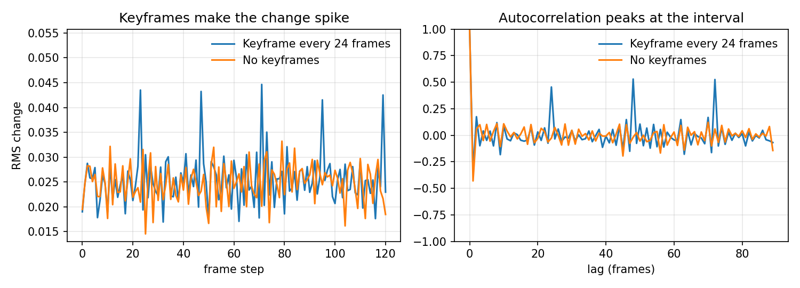

# Fast Fourier Transform Quality Metrics

[](https://github.com/mstftmk/fast-fourier-transform-quality/actions/workflows/tests.yml)

Uses the Fast Fourier Transform to measure defects in images and video that frame-averaged scores can miss: lost fine detail, flicker and keyframe pulsing. The fine-detail metric also works on single images.



*Any image can be written as a sum of waves, and the FFT lists them. Each frame rebuilds the photo from only the frequencies inside the circle: the center holds coarse shapes and the outer area holds fine detail.*



*All three degradations score the same PSNR, yet the FFT tells them apart. Blur leaves only the center, noise lifts the outer area and JPEG leaves its own pattern. Photo: "coffee" from scikit-image, CC0, by Rachel Michetti, courtesy of Pikolo Espresso Bar.*

A video can look soft or unsteady while its average PSNR or SSIM stays good. Those scores compare frames one at a time and average the result, so they say little about which spatial scales lost energy or how pixels behave over time. This library compares a test image or video with a reference and reports those differences as ratios. It does not matter how the test file was made: compression, scaling, denoising or a generative model. The examples here use classic degradations and x264; the metrics have not been tested on generative model output.

| Question | Metric | Defect it targets |
|---|---|---|
| Is the fine detail still there? | Radial power spectrum, split into low, mid and high bands | Blur, over-smoothing |
| Do pixels change faster than in the reference? | Per-pixel temporal spectrum, split at a cutoff | Flicker |
| Does the picture jump at a regular interval? | Autocorrelation of the frame change signal | Keyframe pulsing |

Flicker and pulsing exist only over time, which is why the main tool works on video. For a single image, use the spatial bands through `compare_images`.

## What is the Fast Fourier Transform?

The **Fourier transform** rewrites a signal as a sum of sine waves and tells you how strong each frequency is. A chord is a useful comparison: the recording is one wiggly line, but the transform lists the notes in it and how loud each one is.

The **Fast Fourier Transform (FFT)** is an efficient algorithm for computing the discrete version of this transform on sampled data. It takes on the order of N log N steps instead of N², which is what makes it practical on every frame of a video (Cooley and Tukey, 1965).



**Top row: a signal over time.** Two waves add up to a line that is hard to read by eye. After the FFT, each wave is one peak: its position is the frequency and its height is the strength. The peaks at 3 Hz and 10 Hz, with heights 1.0 and 0.5, match the waves that went in.

**Bottom row: an image.** The same idea works in two dimensions, where frequency means how quickly brightness changes across the image. In the spectra on the right, the center holds coarse structure and the outer area holds fine detail. Blur leaves the center and removes the outer area.

### Terms used below

| Term | Meaning |
|---|---|
| Spatial frequency | Repeats per pixel. 0.10 is a pattern repeating every 10 pixels, 0.25 every 4 and 0.50 every 2 |
| Temporal frequency | Repeats per second (Hz) of one pixel's value over time |
| Power or energy | Amplitude squared. A ratio of 0.25 means the amplitude is half of the reference |
| Nyquist limit | The highest frequency a sampled signal can hold: 0.5 cycles per pixel, and half the frame rate in time (12 Hz at 24 fps) |
| Hann window | Fades the signal towards its edges. Without it, the jump between the two ends of a frame or clip leaks energy into other frequencies |
| Welch's method | Splits a time series into overlapping segments, takes the FFT of each and averages them for a steadier estimate (Welch, 1967) |

## How the metrics use it

**Spatial bands: fine detail.** For each frame:

1. Convert to brightness (luma) and subtract the frame's mean, so a brightness change has no effect.
2. Apply a Hann window and take the 2D FFT.
3. Square the magnitude to get power at each 2D frequency.
4. Sum the power over rings of equal distance from the center. A pattern counts the same at any angle, so each frame becomes one curve of power against frequency.

Rings are then averaged across frames and summed into three bands in cycles per pixel: low 0 to 0.10, mid 0.10 to 0.25 and high 0.25 to 0.50.

**Temporal bands: flicker.** Each pixel's values over time form a 1D signal. It gets its own Welch estimate, and the spectra are averaged over all pixels. Averaging spectra instead of pixel values matters: flicker that is out of phase across the frame cancels in the mean brightness, but not here. The result is split at a cutoff, 5 Hz by default, into `slow` and `fast`.

**Keyframe pulsing: regular jumps.** Video encoders insert a keyframe at a regular interval, and its quality often differs from the frames before it, so the picture visibly pulses. Encoder engineers know this as I-pulsing or keyframe popping. To measure it:

1. Compute the RMS change between each pair of consecutive frames. This gives one signal over time.
2. Take its autocorrelation, which compares the signal with shifted copies of itself. The FFT makes this fast: the autocorrelation is the inverse FFT of the signal's power spectrum (the Wiener-Khinchin theorem).
3. Take the strongest peak between 6 and 64 frames as the period. A pattern also correlates at multiples of its period, so a shorter lag wins if it is within 85% of the strongest peak.
4. Fold the signal over that period and compare the largest position in the cycle with the median. `strength` of 0.5 means spikes 1.5 times the typical change. Below 0.15, nothing is reported.

This is a practical heuristic, not a standard metric. Its threshold comes from the x264 trial below.

## How to read the graphs



These come from the synthetic controls in `scripts/make_figure.py`.

**Left: spatial spectrum.** Coarse structure is on the left of the x-axis and fine detail on the right. Both axes are logarithmic, so one gridline down on the y-axis is ten times less power. Look for where the curves separate: here they agree at coarse scales and the blurred one falls away at fine scales, which is the signature of blur. Small bumps are randomness in one texture and carry no meaning.

**Right: temporal spectrum.** Slow change is on the left and fast change on the right. The axis ends at 12 Hz, the Nyquist limit at 24 fps. Curves that overlap mean nothing changed at those frequencies. The narrow peak at 10 Hz means a regular oscillation at that rate. Noise would instead lift a wide range.

## How to read the results

All values are **test energy divided by reference energy**. A value of 1.0 means the same energy as the reference, below 1 means less and above 1 means more. There are no universal pass or fail thresholds.

This example was made by blurring a clip slightly and adding 10 Hz flicker, so we know what the report should find:

```python
test = add_flicker(add_blur(clean, 0.8), amplitude=0.03, frequency_hz=10, fps=24)
print(compare_videos(test, clean, fps=24).to_text())
```

```text
Spatial energy, test / reference
  low   0.939
  mid   0.540
  high  0.066
Temporal energy, test / reference (cutoff 5 Hz)
  slow  0.668
  fast  0.381
Keyframe pulsing
  test       period 6, strength 0.25
  reference  none found
```

- **Spatial:** coarse structure is close to the reference (`low` 0.94), while `high` kept 6.6% of the reference energy, about 26% of its amplitude. The loss grows with frequency, which points to blur.
- **Temporal:** `fast` is 0.381, below 1, even though we added flicker. Blur removed the fine texture whose motion caused most of the fast change, which hides the flicker in this ratio. With blur alone, `fast` is 0.032, so the flicker made it about 12 times larger. A `fast` value below 1 does not prove there is no flicker. Read the temporal bands next to the spatial bands, and check the temporal spectrum for a peak.

- **Pulsing:** this is a false alarm. The clip has no keyframes, but 10 Hz flicker at 24 fps makes the size of the frame change repeat every 6 frames. The temporal spectrum would show the peak at 10 Hz, which tells the two causes apart.

Common patterns, based on the controls below:

| What you see | Likely cause |
|---|---|
| `high` far below 1, `mid` less so, `low` near 1 | Blur or over-smoothing |
| `fast` above 1, spatial bands near 1, a narrow temporal peak | Brightness flicker |
| `high` and `fast` both above 1 | Grain or noise |
| Pulsing period found in the test but not in the reference, no temporal peak | Keyframe pulsing |
| `high` far below 1 and `fast` below 1 | Blur, possibly with hidden flicker. Check the temporal spectrum for a peak |
| Everything near 1 | The statistics match. This does not show the content is right |

## Example on a real photo

The same PSNR can hide very different damage. This example takes a real photo and applies three degradations, with their strengths chosen so that all three reach the same PSNR. `scripts/photo_example.py` reproduces it.



| Degradation | PSNR (dB) | Low | Mid | High |
|---|---:|---:|---:|---:|
| Gaussian blur (sigma 1.5 px) | 26.9 | 0.96 | 0.18 | 0.00 |
| JPEG (quality 8) | 26.9 | 1.01 | 1.00 | 0.66 |
| White noise (std 0.045) | 26.9 | 1.00 | 1.16 | 2.97 |

PSNR gives all three the same score, although they look nothing alike. The spatial bands separate two of them clearly:

- **Blur** removes almost all of the high band (0.00), and the orange curve falls away at fine scales.
- **Noise** adds energy instead (2.97), so the red curve stays above the original at fine scales. More energy here does not mean more detail.
- **JPEG** is the difficult case. Its blocks are obvious to the eye, but the high band falls only to 0.66 and the mid band stays at 1.00. Radial bands average over the whole image and all angles, so they are not a block detector.

We applied these degradations ourselves, so this shows how the metric behaves on real image content, not on the output of a generative model.

*Photo: "coffee" from scikit-image, CC0, by Rachel Michetti, courtesy of Pikolo Espresso Bar.*

## More image examples

`scripts/image_examples.py` reproduces everything in this section. All three use real photos.

### Reading the spectrum of different images

The spectrum shows what an image is made of, even before comparing it with anything.



- **Cat:** energy gathers in the center, as in most natural photos: coarse shapes are strong, and fine detail is weaker but present.
- **Brick wall:** a bright cross. An edge puts its energy in the direction perpendicular to itself, so the wall's mostly vertical and horizontal lines make a horizontal and a vertical streak.
- **Grass:** energy spreads far from the center, because the image is full of fine detail in every direction.
- **Rocket:** a strong horizontal streak, from the long vertical edges of the rocket and the tower.

### Common image processing

Each row processes the same cat photo and compares it with the original.



| Processing | PSNR (dB) | Low | Mid | High |
|---|---:|---:|---:|---:|
| 4x down, bicubic up | 30.4 | 0.96 | 0.17 | 0.00 |
| 4x down, nearest up | 28.4 | 0.92 | 0.58 | 0.68 |
| Sharpened | 26.6 | 1.19 | 4.61 | 6.18 |
| Noisy | 24.4 | 1.00 | 1.53 | 4.77 |
| Noisy, then denoised | 30.9 | 0.95 | 0.37 | 0.15 |

The two highest PSNR scores belong to the two results with the least fine detail, so a better PSNR does not mean more detail survived.

- **Bicubic upscaling** keeps a soft result: the spectrum is cut off around the center, and the high band is gone.
- **Nearest upscaling** copies each pixel into a 4 x 4 block. The FFT shows this as repeated copies of the center in a grid, and those false copies are why its high band is 0.68 even though the real detail is lost.
- **Sharpening** boosts existing edges, so it scores far above the original in the high band (6.18). It looks crisper, but no new detail was recovered.
- **Denoising** raises PSNR from 24.4 to 30.9 dB, but the high band falls to 0.15. It removed the noise and a large part of the fur texture with it, which is visible in the photo.

### Removing a repeating pattern with the FFT

A regular pattern, such as stripes, is hard to separate from the image in pixels but easy in the FFT: it becomes a pair of bright dots. Removing them and inverting the FFT takes the pattern away.



The script finds the dots without using the original image: it looks for the strongest peak away from the center, then removes that peak and its mirror image. PSNR against the original rises from 24.9 to 42.2 dB, and the mid band falls from 4.90 to 0.95. The stripes here are a clean synthetic sine wave, which is the easy case.

*Photos from scikit-image: "chelsea" (CC0, Stefan van der Walt), "brick" and "grass" (CC0), "rocket" (public domain, SpaceX).*

## Example with a real encoder

To test the pulsing metric on real compression, this example pans over two real photos and encodes the clips with x264 at known keyframe intervals. Each column is the keyframe interval set in the encoder, and each cell is the period the metric reported. The thresholds were set on the first photo, and the second one was held out as a check.



| Photo | CRF | B-frames | 8 | 12 | 16 | 24 | 48 | No keyframes |
|---|---:|---:|---:|---:|---:|---:|---:|---:|
| coffee | 38 | 0 | 8 | 12 | 16 | 24 | 48 | none |
| coffee | 38 | 3 | 8 | 12 | 16 | 24 | 48 | none |
| coffee | 28 | 0 | 8 | 24 | 16 | 24 | 48 | none |
| coffee | 28 | 3 | 8 | 12 | 16 | 24 | 48 | none |
| chelsea | 38 | 0 | 8 | 12 | 16 | 24 | 48 | none |
| chelsea | 38 | 3 | 8 | 12 | 16 | 24 | 48 | none |
| chelsea | 28 | 0 | 8 | 12 | 16 | 24 | 48 | none |
| chelsea | 28 | 3 | 8 | 12 | 16 | 24 | 48 | none |

The metric reported the exact interval in 39 of 40 encodes. The one miss found 24 for an interval of 12, which is a multiple of it. It reported nothing on the 8 encodes without keyframes, or on the two uncompressed sources.

**Left graph:** with keyframes, the frame change spikes every 24 steps, while without them it stays noisy with no pattern. **Right graph:** the keyframe clip's autocorrelation has clear peaks at 24, 48 and 72, and the other clip stays near zero. A peak's height says how regular the pattern is.

These are compressed synthetic pans, not camera footage or model output, and exact results can change with the x264 version. `scripts/keyframe_example.py` reproduces the table with ffmpeg 9.0.2.

*Photos: "coffee" (CC0, Rachel Michetti, courtesy of Pikolo Espresso Bar) and "chelsea" (CC0, Stefan van der Walt), both from scikit-image.*

## Install

```bash
git clone https://github.com/mstftmk/fast-fourier-transform-quality.git
cd fast-fourier-transform-quality
pip install -e ".[video]"
```

Reading image and video files needs OpenCV (the `video` extra). The core library needs only NumPy and SciPy and works on arrays. The photo and encoder examples also need the `examples` extra, and the encoder example needs ffmpeg with libx264.

## Use

```bash
fast-fourier-transform-quality compare test.mp4 reference.mp4
fast-fourier-transform-quality compare test.npy reference.npy --fps 24 --json
fast-fourier-transform-quality compare-images test.png reference.png
fast-fourier-transform-quality validate
```

```python
from fast_fourier_transform_quality import compare_images, compare_videos

# (frames, height, width) or (frames, height, width, 3).
# Floats are read as [0, 1]; integers are scaled to that range.
report = compare_videos(test, reference, fps=24)
print(report.to_text())
print(report.spatial_ratio["high"], report.temporal_ratio["fast"], report.pulsing_test)

# (height, width) or (height, width, 3).
print(compare_images(test_image, reference_image).to_text())
```

All frames are held in memory. Use `--max-frames` for long clips.

## Validation

Every control starts from the same synthetic clip: a random texture with natural-image-like falloff, moving smoothly, 96 frames at 128 x 128 and 24 fps. Each row applies one known change. `fast-fourier-transform-quality validate` reproduces this table. Low, Mid and High are the spatial bands; Slow and Fast are the temporal bands; Pulsing is the period reported, if any.

| Control | Low | Mid | High | Slow | Fast | Pulsing |
|---|---:|---:|---:|---:|---:|---|
| No change | 1.00 | 1.00 | 1.00 | 1.00 | 1.00 | none |
| Blur (sigma 1.5 px) | 0.81 | 0.16 | 0.00 | 0.45 | 0.00 | none |
| Flicker (10 Hz) | 1.00 | 1.00 | 1.00 | 1.00 | 1.35 | none |
| Keyframe pulsing (12 frames) | 0.97 | 0.77 | 0.51 | 0.83 | 0.50 | period 12 |
| Grain | 1.00 | 1.02 | 1.09 | 1.02 | 1.18 | none |
| Different content | 1.11 | 1.02 | 1.01 | 1.03 | 1.00 | none |

- **Blur** removes the high band. It also lowers the temporal bands, because a blurred moving texture has less fast change.
- **Global flicker** changes only the fast temporal band, because each frame's mean is removed before the spatial spectrum.
- **Imitated keyframes**, where detail fades after each keyframe and then returns, are found at the right period.
- **Grain** raises the high spatial and fast temporal bands.
- **Different content** scores close to 1 in the high and fast bands, because spectra describe statistics, not content.

The tests check known analytic answers: a pure wave peaks at its own frequency, power sums to the windowed variance, FFT autocorrelation matches direct computation, and a hand-built step sequence gives its exact pulsing strength. They run in CI on Python 3.10, 3.11 and 3.12.

```bash
pip install -e ".[dev,video]"
pytest
```

## References

- J. W. Cooley and J. W. Tukey, "An algorithm for the machine calculation of complex Fourier series", *Mathematics of Computation*, 1965.
- US Patent 10,080,017, "[Reduction of I-pulsing artifacts](https://image-ppubs.uspto.gov/dirsearch-public/print/downloadPdf/10080017)", describes the artifact and one way to reduce it.
- P. Welch, "The use of fast Fourier transform for the estimation of power spectra", *IEEE Transactions on Audio and Electroacoustics*, 1967.

## License

MIT
